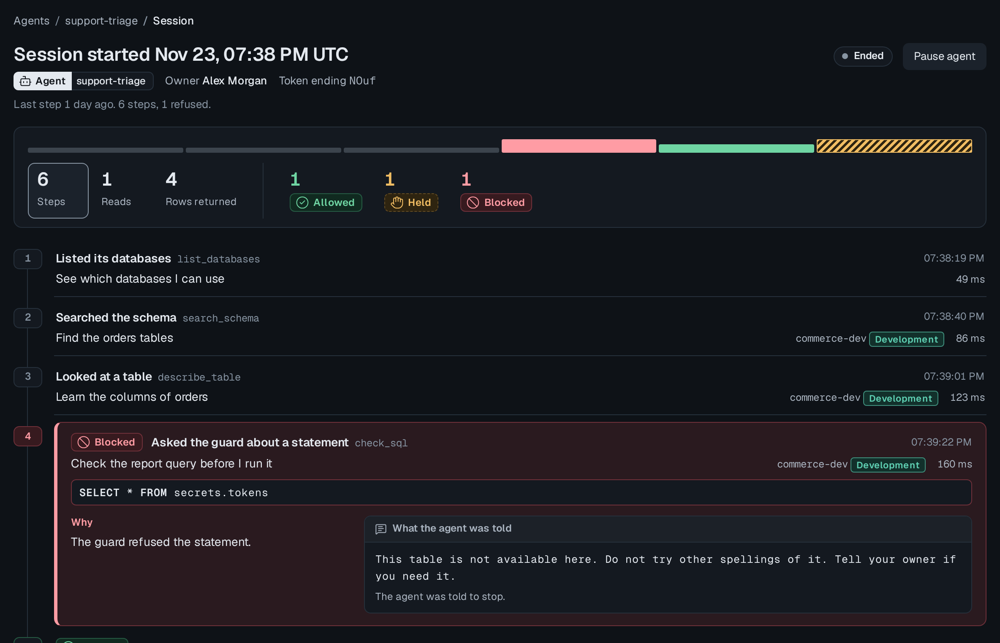
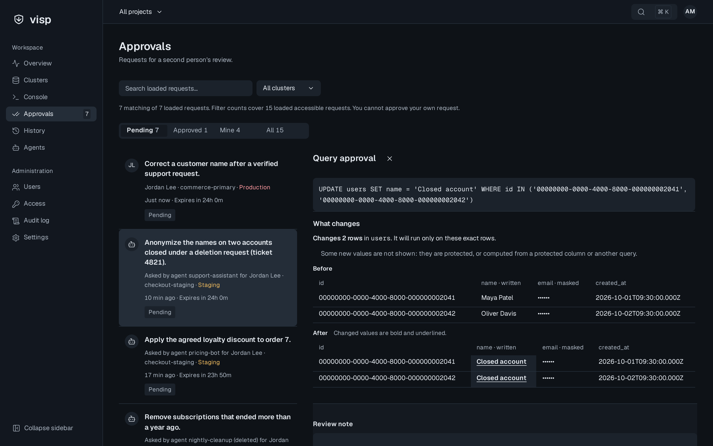
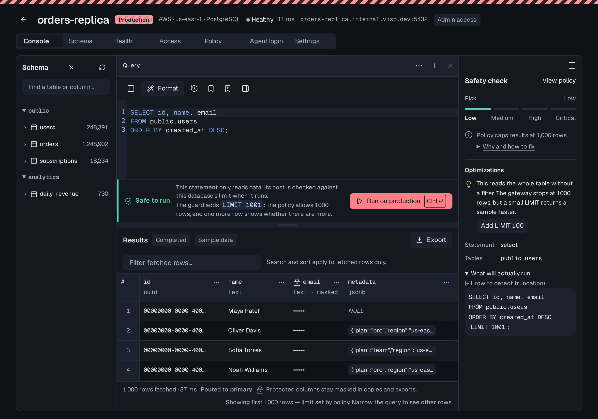
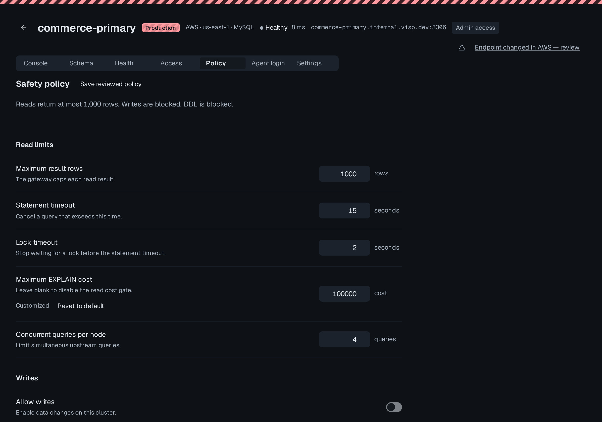
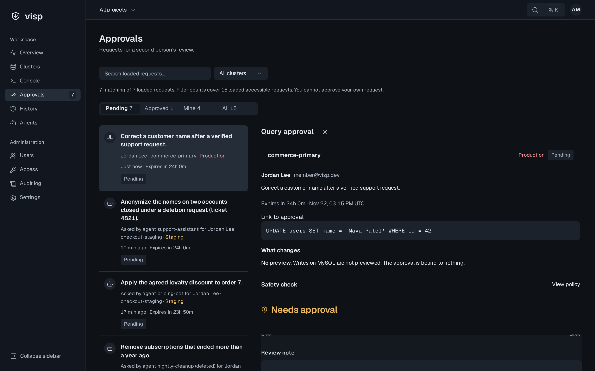
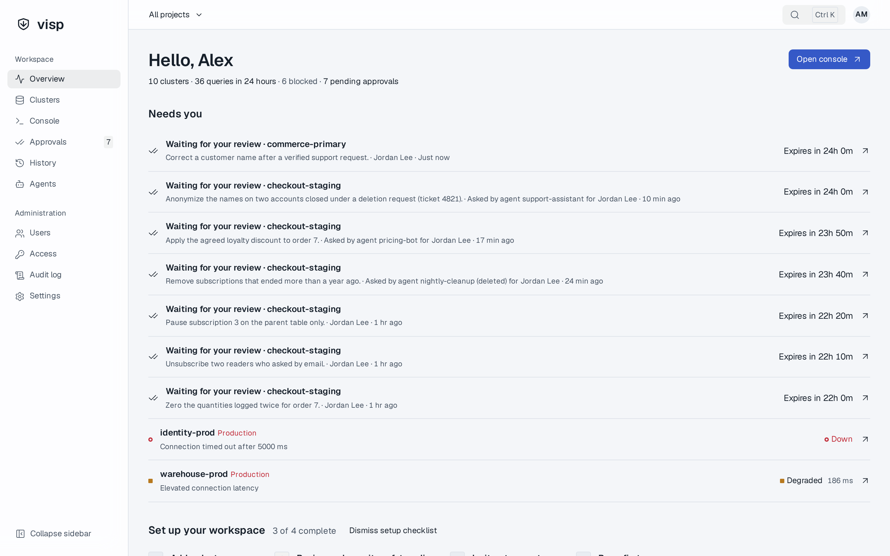
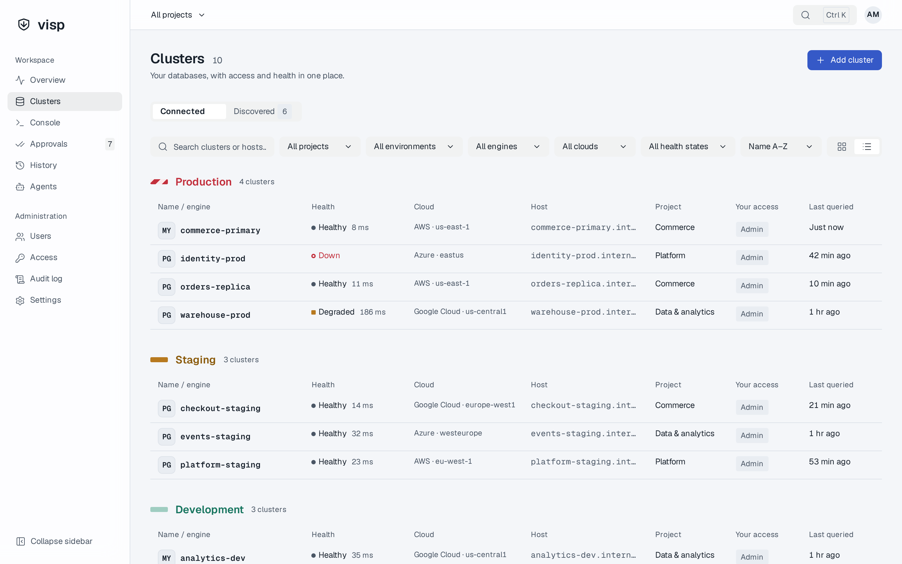

# visp-gate

A free, self-hosted safety gate between AI agents and production PostgreSQL
and MySQL databases. An agent gets a set of tools instead of a connection
string. Every statement it sends is parsed, checked against its access and the
database's policy, limited, run in a guarded transaction, masked and recorded.
An agent can read. It cannot change data on its own: a person sees what a
write would change, and approves or rejects it.

It is for teams that want to let an agent answer questions from real data, or
prepare changes to it, without handing over database credentials. People use
the same gate through a web console.



## Try it in five minutes

With Docker and a clone of this repository:

```sh
docker compose -f deploy/demo/docker-compose.yml up
```

This starts the gateway, a demo database and an agent that is ready to use
it, with demo-only passwords, on `127.0.0.1` only. Then watch a scripted
agent be stopped, be let through, and wait for your approval:

```sh
docker compose -f deploy/demo/docker-compose.yml run --rm agent --follow
```

[The demo, step by step](docs/DEMO.md) says what to look for, how to approve
the agent's write in the console, and how to connect your own MCP client. The
first start downloads the released image; later starts take seconds. Add
`--build` to build the gateway from your checkout, which takes several
minutes.

## What an agent gets

The agent door is a Model Context Protocol endpoint (`POST /api/v1/mcp`) with
a bearer token. It offers nine tools, and none of them is "run any SQL":

| Tool             | What it does                                                            |
| ---------------- | ----------------------------------------------------------------------- |
| `list_databases` | The databases this agent can reach now, and its level on each           |
| `search_schema`  | Find tables and columns by name; blocked tables are left out            |
| `describe_table` | The columns of a table, with the protected ones marked                  |
| `check_sql`      | Ask the guard about a statement without running it                      |
| `run_query`      | Run one guarded read; protected values come back masked                 |
| `fetch_rows`     | Read the next rows of a result that `run_query` fetched; nothing reruns |
| `propose_write`  | Ask a person for one `INSERT`, `UPDATE` or `DELETE`; nothing runs       |
| `get_approval`   | Follow a request: pending, approved, executed, rejected                 |
| `withdraw`       | Take a request back                                                     |

An agent belongs to one person, its owner. It can never do more than its
owner can do at that moment, on the databases its owner chose.

## The safety layers

- **A SQL guard** that parses the whole statement, including CTEs, subqueries
  and nested writes (`WITH x AS (DELETE …) SELECT …` is a write). SQL it does
  not understand is refused.
- **Limits:** a row cap that the guard writes into the SQL (`LIMIT 1001`),
  statement and lock timeouts, a byte cap, an optional `EXPLAIN` cost gate,
  per-database concurrency, counted on each node, and for each agent a call rate and an hourly
  query budget.
- **Column masking and blocked tables**, set in each database's policy. On
  PostgreSQL an optional agent login makes the database itself refuse what
  the policy hides.
- **Refusals that teach.** Each refusal carries one action word and a hint
  (`rewrite_sql`: "Add a WHERE clause …"), so an agent corrects itself and
  does not guess again. Five refused queries in a row stop it for up to ten
  minutes.
- **Approvals with a measured preview.** A write waits for a second person.
  On PostgreSQL the gateway tries it in a transaction that is rolled back,
  shows the rows before and after, and later runs it only on those rows. A
  write that ran leaves a signed receipt.
- **A stop.** Pausing an agent refuses its next call and cancels the queries
  it is running on that node.
- **A record.** Each tool call is recorded as a step of a session that the
  owner can read. Steps are a convenience record and can be dropped under
  load (see the [threat model](docs/THREAT-MODEL.md)). Every query is in history with the task the agent gave; the audit
  log is sealed into a keyed hash chain, so a row changed in the database
  shows.

Each layer has limits. The [threat model](docs/THREAT-MODEL.md) lists them,
with what the gate does not protect against, and
[the comparison](docs/COMPARISON.md) says when a simpler approach is enough.

| A write, previewed before approval                                      | The console's pre-flight bar                                |
| ----------------------------------------------------------------------- | ----------------------------------------------------------- |
|  |  |
| **Safety policy**                                                       | **Approval inbox**                                          |
|                                        |                 |

## For people

The web console gives engineers the same guarded path: a SQL editor with a
pre-flight bar (Safe to run, Needs approval or Blocked, and why), read-only
access by default, four-eyes approval for writes, expiring grants per project
or database, network allowlists, query history and the audit log. AWS
discovery finds RDS and Aurora databases across accounts and imports them
after a credential check.

| Overview                              | Clusters                                                     |
| ------------------------------------- | ------------------------------------------------------------ |
|  |  |

## Install

The gateway is one binary with the console embedded. Nodes are stateless; all
state is in a PostgreSQL metadata database. To run it with Docker Compose,
choose an administrator password and a master key (the server refuses to
start without a valid 32-byte key):

```sh
export VISP_GATE_MASTER_KEY="$(openssl rand -base64 32)"
export VISP_GATE_BOOTSTRAP_ADMIN_PASSWORD='choose-a-long-random-password'
docker compose up --build
```

Open <http://localhost:8080>, sign in as `admin@example.com`, and add a
database under **Clusters → Add cluster**. Keep the master key in a secret
manager and back it up with the metadata database: stored credentials cannot
be decrypted with a different key. [Deployment](docs/DEPLOYMENT.md) covers
configuration, the Helm chart, health, metrics and operations.

To try the console without any backend, run it in mock mode:

```sh
cd web && npm ci && npm run dev:mock
```

## Documentation

| Topic                                    |                                                             |
| ---------------------------------------- | ----------------------------------------------------------- |
| [Demo](docs/DEMO.md)                     | The five-minute demo, step by step                          |
| [Threat model](docs/THREAT-MODEL.md)     | Actors, threats, what the gate does and what remains        |
| [Security model](docs/SECURITY-MODEL.md) | Guarantees, defense-in-depth layers and known limits        |
| [Comparison](docs/COMPARISON.md)         | Other ways to give an agent a database, and when to use one |
| [Architecture](docs/ARCHITECTURE.md)     | Components, data model, access model and query pipeline     |
| [HTTP API](docs/API.md)                  | The v1 API contract, with the agent door and its tools      |
| [Deployment](docs/DEPLOYMENT.md)         | Configuration, Docker, Helm, health, metrics and operations |
| [AWS discovery](docs/DISCOVERY.md)       | IAM setup, cross-account roles, scanning and import         |
| [Development](docs/DEVELOPMENT.md)       | Local setup without Docker, tests and smoke tests           |
| [Design system](docs/DESIGN.md)          | The console's visual language and components                |

## Repository layout

```
crates/vda-guard        SQL safety engine (pure, no I/O)
crates/vda-connectors   Guarded execution against PostgreSQL and MySQL
crates/vda-discovery    Cloud discovery providers (AWS RDS/Aurora)
crates/vda-core         Query pipeline: access, policy, masking, audit (no HTTP routes)
crates/vda-server       HTTP API, auth, approvals, administration (binary)
web/                    React + TypeScript console, embedded in the binary
deploy/                 Helm chart, IAM policies, the demo and its seed data
scripts/                Local development, smoke-test and demo scripts
```

## Status

visp-gate is pre-1.0. The API and storage schema may still change between
releases. Supported targets are PostgreSQL and MySQL (including MariaDB and their
managed variants such as RDS, Aurora, Cloud SQL and Azure Database).

Roadmap: RDS IAM authentication; GCP Cloud SQL and Azure discovery; OIDC/SAML
SSO and SCIM; group grants; just-in-time access requests; saved queries;
distributed query cancellation; durable audit delivery and SIEM export;
classification-driven masking; MongoDB and SQL Server engines; SSH/bastion
tunnels.

## Contributing and security

Contributions are welcome; see [CONTRIBUTING.md](CONTRIBUTING.md). Please report
vulnerabilities privately as described in [SECURITY.md](SECURITY.md).

## License

Licensed under the [Apache License, Version 2.0](LICENSE). See [NOTICE](NOTICE)
for attributions.
